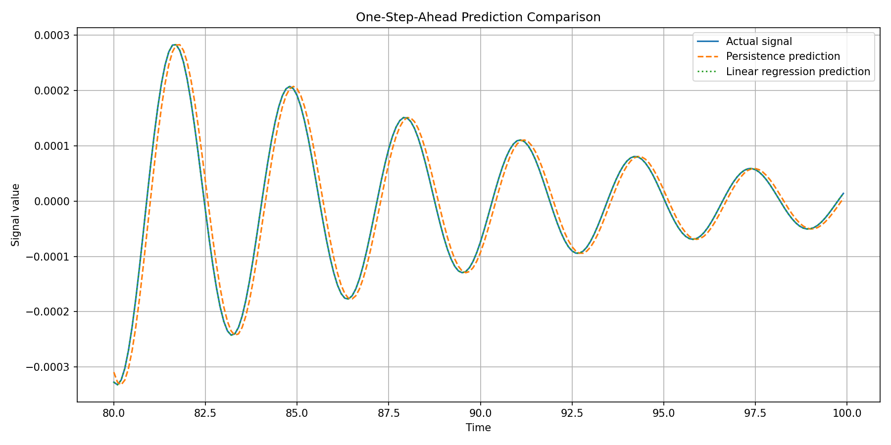

# Damped Oscillator Baseline: Persistence vs Linear Regression

Compare two next-step prediction approaches:

- **Persistence baseline:** Predicts the next value using the current observed value.
- **Linear regression:** Predicts the next value using the previous five observations.

The methods are compared using next-step Mean Absolute Error.

## Signal Generation

The synthetic signal is defined as:

```
x(t) = exp(-0.1t) * cos(2t)
```

The signal represents an oscillation whose amplitude decreases exponentially over time.

## Experimental Settings

| Parameter | Value |
|---|---|
| Sampling interval | 0.1 time units |
| Signal duration | 100 time units |
| Number of signal samples | 1,000 |
| Input window size | 5 observations |
| Training split | 60% |
| Development split | 20% |
| Final test split | 20% |
| Evaluation metric | Mean Absolute Error (MAE) |

## Methodology

### 1. Dataset Construction

A sliding-window approach creates the prediction dataset. Each input contains the five preceding signal observations, and the target is the next observation.

For example:

```
Input:  [x(t-5), x(t-4), x(t-3), x(t-2), x(t-1)]
Target: x(t)
```

### 2. Chronological Data Splitting

Examples are divided according to their target time:

- Training: first 60%
- Development: next 20%
- Final test: last 20%

The original signal contains 1,000 samples. Since five observations are needed to construct the first input window, the dataset contains 995 prediction examples.

| Dataset | Number of examples |
|---|---|
| Training | 595 |
| Development | 200 |
| Final test | 200 |

Historical observations from earlier time points may be used as inputs for predictions in a later partition. Future observations are not used as input features.

### 3. Linear Regression Model

A Scikit-learn pipeline combines `StandardScaler` and `LinearRegression`.

The scaler is fitted using training features only. Its learned statistics are reused unchanged for development and final-test features. The model is trained exclusively on the training partition.

### 4. Persistence Baseline

The persistence baseline predicts the next observation using the current observation:

```
Prediction(t+1) = x(t)
```

This simple baseline provides a reference against which the linear regression model is evaluated.

### 5. Evaluation Metric

Mean Absolute Error (MAE) measures the average absolute difference between actual and predicted values:

```
MAE = mean(abs(actual values - predicted values))
```

A lower MAE indicates smaller average absolute prediction errors.

## Correction Note

A reporting error in the results DataFrame was corrected in a follow-up commit. The "Development MAE" column (previously labeled "Development Test MAE") had been filled with final-test values, so it duplicated the "Final Test MAE" column. It now uses the development-set MAEs.

- Original commit: [ORIGINAL_COMMIT_HASH_OR_LINK] (preserved unchanged)
- Correction commit: [CORRECTION_COMMIT_HASH_OR_LINK]
- No retraining, model or split changes, new benchmarks, or final-test tuning were performed for this correction.

## Results

The following values were checked against the corrected notebook output (see Correction Note).

| Method | Development MAE | Final Test MAE |
|---|---|---|
| Persistence | 1.4041e-04 | 1.8377e-05 |
| Linear Regression | 6.9237e-18 | 1.6326e-18 |

## Results Interpretation

Linear regression achieves a substantially lower MAE than the persistence baseline on both the development and final-test sets. Its error is effectively zero at the numerical precision shown.

This result is plausible because the signal is deterministic and equally spaced in time. A damped cosine signal follows a second-order linear recurrence relationship, allowing its next value to be represented as a linear combination of preceding values. The five-observation input window provides enough historical information for linear regression to learn this relationship.

This demonstrates strong performance on this particular synthetic signal; it does not establish that the same performance would generalize to noisy or more complex real-world datasets.

## Prediction Visualization

The notebook generates a plot comparing actual signal values, persistence predictions, and linear regression predictions. The plot is saved as `prediction_comparison.png`.

If the image is stored in the same directory as this README, it can be displayed with:

```markdown

```

## Leakage Prevention

- Data is split chronologically rather than randomly shuffled.
- Partition membership is determined by target time.
- The model is trained using training data only.
- `StandardScaler` is fitted using training features only.
- The fitted scaler is reused unchanged for development and test data.
- The development set is used for comparison before final evaluation.
- The final test set is reserved for the final performance assessment.

The first predictions in a new partition may use observations from earlier time points because these are legitimate historical inputs. Future target values are not used to construct input features.

## Limitations

- The experiment uses a deterministic synthetic signal rather than real-world scientific measurements.
- The signal contains no added measurement noise.
- Results depend on the selected signal and sampling interval.
- Extremely small MAE values should be interpreted relative to the signal's scale and floating-point precision.
- Performance on this signal does not guarantee performance on other time series or real-world scientific ML tasks.

## Technologies Used

- Python
- NumPy
- Pandas
- Matplotlib
- Scikit-learn
- Google Colab

## How to Run

1. Open `damped_oscillator_baseline.ipynb` in Google Colab or Jupyter.
2. Install the required libraries if they are not already available.
3. Run the notebook cells from beginning to end.
4. Review the printed MAE comparison and results interpretation.
5. Inspect the prediction visualization.

Install dependencies with:

```bash
pip install numpy pandas matplotlib scikit-learn
```

### Environment (correction run)

- Command: `[YOUR_SINGLE_RUN_COMMAND]`
- Python [x.y.z]
- NumPy [x.y.z]
- pandas [x.y.z]
- Matplotlib [x.y.z]
- scikit-learn [x.y.z]

## Project Structure

```
scientific-ml-evaluation/
├── README.md
├── damped_oscillator_baseline.ipynb
└── prediction_comparison.png
```

## Conclusion

This experiment compares a linear regression predictor against a persistence baseline for next-step prediction of a synthetic damped oscillator. Linear regression achieves near-zero prediction error on this particular deterministic signal.

The experiment emphasizes reproducible implementation, chronological evaluation, training-only preprocessing, baseline comparison, and honest interpretation of model performance and limitations.
